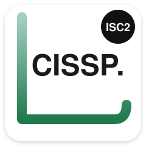
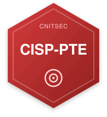
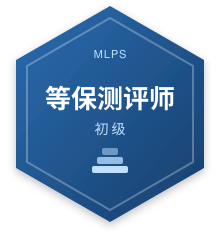

### 💬 Broccoli

安全这行干到第 8 年。乙方做过安全交付，甲方待过互联网，现在关心的是怎么把一家企业的安全从零建起来，以及 AI 能在里头干什么。

- 服务过 60+ 家单位，交付过 70+ 个项目，搭过安全体系，带过小团队
- CVE 编号 3 个：CVE-2022-38605 / CVE-2022-38606 / CVE-2022-38610；另有 CNVD 高危漏洞证书 4 项、CNNVD 个人漏洞编号 3 项
- 主要做企业安全建设方向

> 8 years in security — vendor-side delivery and in-house program building. Penetration testing, security services, and building security programs from scratch.

**Certificate: CISSP / OSCP+ / CISP-PTE / 网络安全等级测评师**

  
  
  
  

**在做的事**：企业安全建设、渗透测试、安全服务。另外在读人工智能硕士(非全)，琢磨 AI 和安全怎么结合。

📫 sunaono1@163.com

